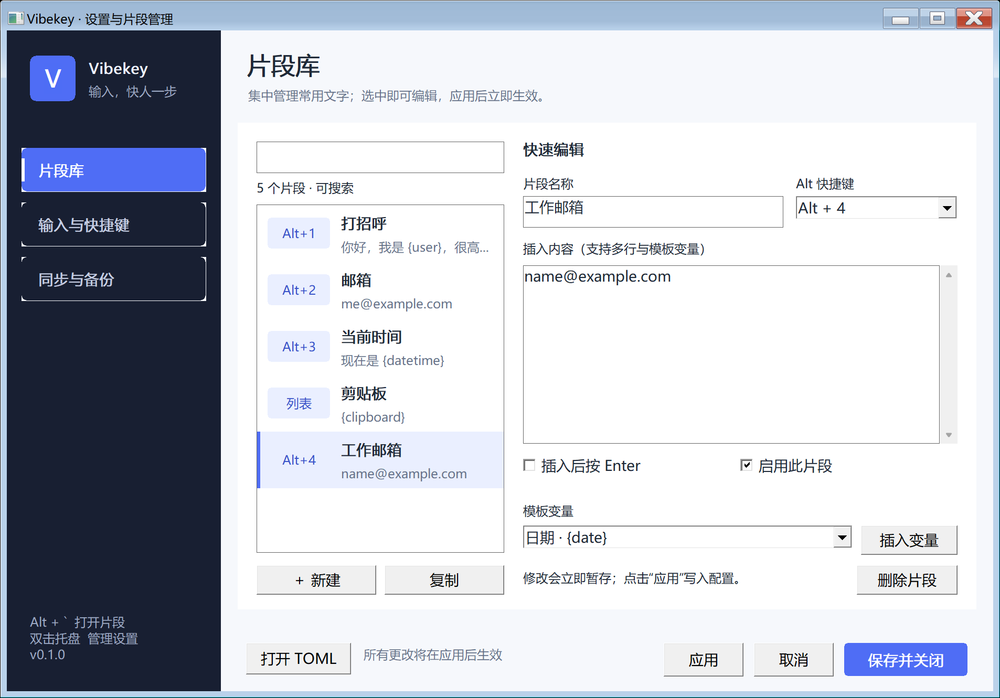
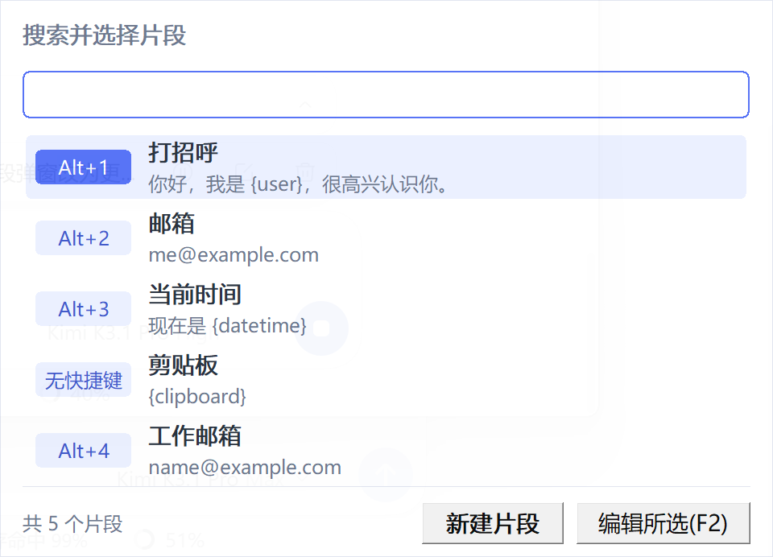
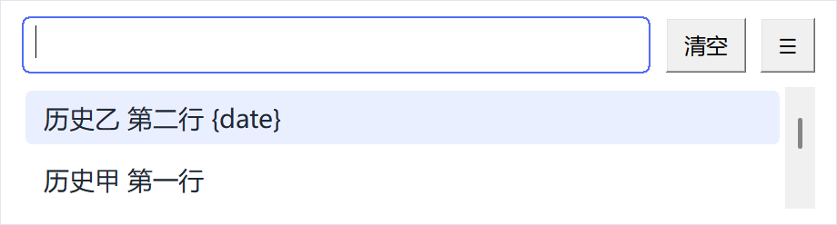

# Vibekey

按住 **Alt** 再按数字键，就能把预先配置好的文字直接输入到当前窗口 —— 常驻托盘、
纯文本配置、支持 WebDAV 同步的 Windows 小工具。

Vibekey 是给“高频重复输入”准备的：自我介绍、邮箱、地址、工单模板、常用回复……
在图形化片段库（或直接编辑 `config.toml`）里写好文本，之后在任意程序里按 Alt+1 直接出字，不用切窗口、不用打开输入法。

## 功能特性

- **Alt + 数字直接出字**：单文件便携 exe，常驻托盘，无主窗口，不打断当前操作。
- **快捷键可配置**：默认 Alt+1 … Alt+0、Alt+-、Alt+= 共 12 个槽位；片段也可以不绑定快捷键，只在列表里出现。
- **两种触发方式**：`immediate`（按下即触发）和 `hold`（Alt 必须先按住超过 `hold_ms` 毫秒才响应数字片段，减少误触；列表/菜单热键不受影响）。
- **两种注入方式**：`paste`（剪贴板 + Ctrl+V，中文/Unicode 最稳，默认）和 `type`（SendInput 逐字符输入，适合不允许动剪贴板的程序）。启用剪贴板恢复时，如果剪贴板里是文件/图片/富文本，会自动改用逐字符输入，**不会破坏原剪贴板**。
- **紧凑半透明片段弹窗**：Alt+反引号打开，460 逻辑像素宽、最多 6 行，约 95% 不透明度；无标题和底栏，每项只显示一行，搜索栏右侧“☰”打开完整菜单。支持搜索、↑↓、Enter、单击和 Esc；F2 或右键立即编辑。
- **文本剪贴板历史**：默认 Alt+V 打开，类似 Win+V 的搜索、选择和粘贴体验；保留最近 50 条，重复内容自动置顶，Delete 删除选中项，也可一键清空。历史仅保存在内存中，退出即清除，不写入磁盘，也不抢占系统 Win+V。
- **图形化片段库**：新建、复制、删除、搜索片段，直接编辑名称、Alt 槽位、多行内容、回车和启用状态，并可一键插入模板变量。
- **配置菜单**：Alt+Backspace 或右键托盘打开；新建片段、设置、编辑 TOML、重新加载、立即同步、开机启动、日志、关于、退出。
- **统一设置中心**：双击托盘图标打开，可视化管理全部输入行为、全局热键、忽略程序、WebDAV 同步和备份选项；支持应用后不关闭窗口继续调整。
- **模板变量**：`{date}`、`{time}`、`{datetime}`、`{clipboard}`、`{user}`、`{host}`。
- **配置热重载**：手动改 `config.toml` 保存后自动生效；写坏了不会崩溃，保留旧配置并提示。
- **WebDAV 同步与内容加密**：多台机器共用一份配置（Basic 认证）；可选 AES-256-GCM 加密和完整性认证，独立同步密码经 PBKDF2 派生密钥，HTTP 下也不直接暴露片段正文；冲突备份同样加密。两类密码分别用 Windows DPAPI 保存，不随配置同步。
- **Windows 7 SP1 支持**：提供 32/64 位 Win7 专用产物；同样的 exe 也能在 Windows 10/11 上运行。
- **单实例、文件日志、崩溃防护**：`%APPDATA%\Vibekey\` 下保存配置、日志和同步状态。

## 快捷键

| 快捷键 | 功能 |
| --- | --- |
| Alt + 反引号（数字 1 左边的 · 键） | 打开单行片段列表弹窗 |
| Alt + V | 打开文本剪贴板历史（可在设置中修改；不默认占用系统 Win+V） |
| Alt + 1 … Alt + 9、Alt + 0、Alt + -、Alt + = | 直接插入 `config.toml` 中绑定到对应 `key` 的片段（共 12 个槽位） |
| Alt + Backspace | 打开配置菜单（与右键托盘图标相同） |

片段列表里：输入关键字过滤，↑ / ↓ 选择、Enter 插入、Esc 关闭；单击条目立即插入；**F2 / 右键条目**打开快速编辑；搜索栏右侧 **☰** 打开新建、设置等完整菜单。

剪贴板历史里：同样支持搜索、↑↓、Enter、单击和 Esc；在列表上按 **Delete** 删除选中项，点搜索栏的「清空」删除全部。多行内容折叠成单行预览，粘贴时保留原文，且 `{date}` 等字符不会被再次展开。点击其它窗口或失焦都会关闭弹窗。

托盘图标：左键单击打开片段列表，双击打开设置窗口，右键打开配置菜单。

> 快捷键可以在 `[hotkeys]` 里改；片段槽位由每条 `[[snippet]]` 的 `key` 决定。
> 全局快捷键会和占用 Alt+数字的程序冲突，可用 `ignore_apps` 或 `hold` 模式规避，
> 详见 [docs/config.md](docs/config.md)。

## 下载与安装

发布产物是**便携版单文件**，不需要安装程序、不写系统目录：

1. 从 Releases 下载对应目录/压缩包：
   - `vibekey-<version>-win7-x64/`：64 位（Windows 7 SP1 x64 / Windows 10/11 x64）
   - `vibekey-<version>-win7-win32/`：32 位（32 位 Windows 7/10/11，也可在 64 位系统上通过 WoW64 运行）
2. 把 `vibekey.exe` 放到任意目录（建议不含空格和中文，例如 `C:\Tools\vibekey\`），双击运行。
3. 托盘出现图标后即可使用；首次启动会在 `%APPDATA%\Vibekey\` 下生成 `config.toml` 和日志。
4. 想开机自启：配置菜单 →「开机启动」，或双击托盘打开设置窗口勾选。

卸载：退出程序（菜单「退出」），删除 exe 和 `%APPDATA%\Vibekey\` 目录即可；
如果开过开机启动，先取消勾选。

### 重要：Windows 7 必须用 Win7 构建产物

- 本项目的发布产物分两种：
  - **Win7 构建**（`win7-x64` / `win7-win32` 目录）：用 tier 3 的 `*-win7-windows-gnu` 目标 +
    llvm-mingw MSVCRT 交叉编译，能在 **Windows 7 SP1** 及更高版本运行。
  - **Windows 原生构建**（CI 的 `vibekey-windows-native` artifact，普通 stable MSVC 构建）：
    **只能在 Windows 10/11 上运行**，因为 Rust 1.78 起官方预编译 std 的 `*-pc-windows-*`
    目标最低要求 Windows 10。
- 在 Win7 上请务必使用 `win7-x64` / `win7-win32` 产物；拿普通 MSVC 构建放到 Win7 会启动即失败。
- Win7 需要 **SP1**；不需要装 UCRT、VC++ 运行库或 .NET。原因和细节见 [docs/win7.md](docs/win7.md)。

### 安全提醒

- exe **没有代码签名**：首次运行可能出现 SmartScreen 提示（更多信息 → 仍要运行），
  部分杀毒软件也可能因“全局键盘钩子 + 模拟按键”而误报。请只从可信来源下载。
- 发布包根目录（`dist/`）附带 `SHA256SUMS`，下载后建议校验：

  Linux / macOS：

  ~~~
  cd dist
  sha256sum -c SHA256SUMS
  ~~~

  Windows PowerShell：

  ~~~
  Get-FileHash .\vibekey.exe -Algorithm SHA256
  ~~~

  把输出与 `SHA256SUMS` 中对应 exe 的行比对，不一致就不要再运行。
- WebDAV 登录密码与独立配置加密密码分别用 DPAPI 保存，只有当前 Windows 用户能解密；不会写入 TOML 或日志。启用 `sync.encrypt` 后，远端配置与冲突备份为认证密文，但本地 `config.toml` 和本地 `.bak` 仍是明文。
- 配置加密只保护正文：HTTP 仍会暴露 Basic 登录凭据、URL、文件大小/时间，也无法阻止服务器回滚到旧密文。正式使用仍应走 HTTPS + 应用密码。
- 程序默认不联网，只有开启 WebDAV 同步后才会访问你填写的 URL。
- Windows 7 已停止官方支持，建议只在隔离环境或内网使用。

## 快速开始

1. 双击 `vibekey.exe`，托盘出现 Vibekey 图标。
2. 打开记事本，按 **Alt+1**：应插入默认片段“你好，我是 <用户名>，很高兴认识你。”。
3. 按 **Alt+反引号**：光标附近弹出单行片段列表，输入关键字搜索，用 ↑↓ + Enter 选择其他片段。
4. 选中一个片段后按 **F2**（或右键条目），即可修改名称、快捷键和内容；点「应用」立即生效，窗口可继续编辑。
5. 复制几段文字后按 **Alt+V**：搜索历史并按 Enter 粘贴；在列表中按 Delete 删除一条，或点「清空」全部删除。
6. 双击托盘图标打开完整片段库，可新建、复制、删除、搜索和批量调整各个输入项。仍喜欢纯文本时，也可用 Alt+Backspace →「编辑 TOML 配置」。

## 图形化片段管理

双击托盘图标，或按 Alt+Backspace →「设置与片段管理…」，打开统一设置中心：

| 区域 | 可以做什么 |
| --- | --- |
| 片段库 | 搜索、新建、复制、删除；直接修改名称、Alt 槽位、多行正文、插入后回车、启用状态 |
| 输入与快捷键 | 输入方式、剪贴板恢复、immediate/hold、按住时长、片段/历史/菜单三个全局热键、忽略程序、开机启动 |
| 同步与备份 | WebDAV 地址/登录凭据、配置加密开关与独立密码、间隔、超时、保存后同步、冲突备份、连接/解密测试、清除密码 |

编辑内容会先暂存在窗口中。「应用」校验并原子写入配置、保持窗口打开；「保存并关闭」应用后退出；「取消」不会写入未应用的更改。若编辑期间文件被外部程序或同步修改，保存前会要求确认，避免静默覆盖。

在正文编辑器中可用「模板变量 → 插入变量」把变量放到当前光标处。快捷键槽位与全局热键冲突时会在保存前提示，不会把整组快捷键静默禁用。

## 配置文件

配置文件是纯文本 TOML，路径：

~~~
%APPDATA%\Vibekey\config.toml
~~~

完整示例见 [assets/config.example.toml](assets/config.example.toml)，
每个字段的类型、默认值和校验规则见 [docs/config.md](docs/config.md)。

一个最小可用的配置：

~~~toml
activation = "immediate"      # immediate：按下即触发；hold：Alt 按住超过 hold_ms 数字片段才触发
hold_ms = 350
input_method = "paste"        # paste：剪贴板 + Ctrl+V；type：逐字符输入
restore_clipboard = true
start_with_windows = false
ignore_apps = ["photoshop.exe"]

[hotkeys]
list = "alt+`"
config = "alt+backspace"
history = "alt+v"

[[snippet]]
key = "1"
name = "打招呼"
text = "你好，我是 {user}，很高兴认识你。"

[[snippet]]
key = "2"
name = "邮箱"
text = "me@example.com"

[[snippet]]
key = ""                      # 不绑定快捷键，只出现在列表里
name = "剪贴板内容"
text = "{clipboard}"
~~~

片段文本支持模板变量：

| 变量 | 展开为 |
| --- | --- |
| `{date}` / `{time}` / `{datetime}` | 本地日期 / 时间 / 日期时间 |
| `{clipboard}` | 触发时剪贴板中的文本 |
| `{user}` / `{host}` | Windows 用户名 / 计算机名 |

写 `{{date}}` 输出字面量 `{date}`；未知变量原样保留。

修改配置后程序会自动检测并重新加载；手动改坏（例如少个引号）时会提示并保留旧配置，
不会导致程序崩溃。设置窗口保存采用原子替换。

## WebDAV 同步

多台机器可以共用一份 `config.toml`。同步只传输配置文件本身，**密码不在文件里**。

1. 双击托盘图标（或 Alt+Backspace →「设置与片段管理…」），切到「同步与备份」。
2. 填写 WebDAV 文件 URL、用户名和登录密码。勾选「加密远端配置正文」，再填写至少 8 个字符的**独立同步加密密码**（不是复用上面的登录密码字段）。
3. 点「测试连接」：如果远端已有加密配置，会同时验证密码和密文完整性；成功后保存。新机器需先勾选加密并填写同一同步密码，再执行首次同步。
4. 保存后会立即同步一次；之后按 `interval_minutes` 定时同步，保存配置后也会同步（`sync_on_change`）。旧明文远端会迁移为密文；更换加密密码时会保留旧密码直至新密文和同步状态均保存成功，轮换未确认前需先同步、再换成其他新密码。

URL 必须指向**文件**（不是目录），常用写法：

~~~toml
# Nextcloud
url = "https://cloud.example.com/remote.php/dav/files/<用户名>/vibekey/config.toml"
# 坚果云
url = "https://dav.jianguoyun.com/dav/vibekey/config.toml"
# 自建 WebDAV
url = "https://dav.example.com/vibekey/config.toml"
~~~

同步规则（详细说明见 [docs/webdav.md](docs/webdav.md)）：

- 只有本地改动 → 上传；只有远端改动 → 下载，本地旧文件备份为 `config.toml.bak`。
- 两端都改 → **本地优先**：远端版本先备份为 `<url>.remote-backup-<时间戳>.toml`，再用本地覆盖远端。
- 新机器首次同步且远端已有配置 → 以远端为准。
- 远端文件解析失败时拒绝覆盖本地。
- 远端目录不存在会自动创建（MKCOL）。
- 目前只支持 **Basic 认证**；建议启用配置加密、使用 HTTPS 和服务商提供的“应用密码”。加密开启后，远端冲突备份也是密文，不能直接用文本编辑器查看。
- 忘记加密密码无法解开远端密文；本机明文配置和本地 `.bak` 不受此影响。已加密远端若被替换成明文，程序会拒绝同步以防止 HTTP 降级。

## Windows 7 支持

- 支持 **Windows 7 SP1** 32/64 位，同一份 exe 也兼容 Windows 10/11。
- 因为 Rust 1.78 之后普通 `*-pc-windows-*` 目标的预编译 std 要求 Windows 10，
  Win7 产物必须用 tier 3 的 `*-win7-windows-gnu` 目标 + nightly + `-Z build-std`
  + llvm-mingw（MSVCRT 版）交叉编译。
- 产物只依赖 Win7 自带的系统 DLL（`msvcrt.dll` 等），不需要 UCRT/VC++ 运行库/.NET。
- Win7 SP1 补丁要求、TLS 说明、常见启动失败原因见 [docs/win7.md](docs/win7.md)。

## 从源码构建

### Linux 交叉编译 Win7 版本（发布用，推荐）

依赖：rustup、curl、tar、xz-utils。工具链安装脚本会把 llvm-mingw 和 nightly + rust-src
装到 `~/toolchains` / rustup 目录，不需要 root：

~~~
# 一次性安装交叉编译工具链
scripts/install-toolchain.sh

# 构建 64 位和 32 位
. scripts/dev-env.sh
scripts/build-win.sh x86_64-win7-windows-gnu
scripts/build-win.sh i686-win7-windows-gnu

# 等价的手写命令
cargo +nightly build --release -Z build-std=std,panic_abort \
    --target x86_64-win7-windows-gnu -p vibekey

# 校验 PE（子系统版本 + 导入表白名单）
scripts/verify-win7-pe.sh target/x86_64-win7-windows-gnu/release/vibekey.exe

# 生成发布目录 dist/vibekey-<version>-win7-x64/ 与 -win7-win32/（含示例配置、README、文档、SHA256SUMS）
scripts/package-release.sh

# 只测试平台无关的 core
cargo test -p vibekey-core
~~~

工具链目录/版本可用环境变量覆盖：`VIBEKEY_TOOLCHAIN_DIR`、`VIBEKEY_LLVM_MINGW_VERSION`。

### Windows 本机构建（Windows 10/11）

安装 stable Rust 和 Visual Studio Build Tools（MSVC 链接器），然后：

~~~
cargo build --release -p vibekey
# 产物：target\release\vibekey.exe（x86_64-pc-windows-msvc）
~~~

注意：这个原生构建**不能**在 Windows 7 上运行，Win7 请用上面的交叉编译产物。
如果只想跑测试（不依赖 Windows）：

~~~
cargo test -p vibekey-core
~~~

### CI

[.github/workflows/build.yml](.github/workflows/build.yml) 包含三个 job：

- `core-test`：Ubuntu 上跑 `cargo test -p vibekey-core`，并校验示例配置。
- `win7-cross`：Ubuntu 上安装 nightly + rust-src、下载 llvm-mingw、构建两个 Win7 target、
  用 `scripts/verify-win7-pe.sh` 校验并上传 artifact（`dist/`）。
- `windows-native`：windows-latest 上用 stable MSVC 构建，作为 Win10+ 产物。

## 项目结构

~~~
Cargo.toml                  workspace（core + win 两个 crate）
AGENTS.md                   开发/交接说明（在 Windows 上接手本项目时先读）
crates/vibekey-core/        平台无关：配置 / 快捷键 / 模板展开 / 同步 / 状态 / 密码抽象
crates/vibekey-win/         Win32 前端：托盘 / 键盘钩子 / 注入 / 列表 / 菜单 / 设置 / DPAPI / 同步线程
scripts/
  install-toolchain.sh      一次性安装 llvm-mingw + nightly/rust-src
  dev-env.sh                source 后设置交叉编译 PATH / CC / AR / 链接参数
  build-win.sh              构建指定 Win7 target
  verify-win7-pe.sh         校验 PE 子系统版本与导入表（Win7 兼容）
  package-release.sh        构建并生成 dist/ 发布目录 + SHA256SUMS
docs/
  design.md                 设计文档
  spec-win-app.md           Windows 前端实现规范
  config.md                 配置字段参考
  win7.md                   Win7 构建、校验与系统要求
  webdav.md                 WebDAV 服务端设置与冲突策略
  testing.md                Windows 手工测试清单（含本地 WebDAV 起法）
assets/config.example.toml  可直接复制的示例配置
.github/workflows/build.yml CI
dist/                       发布产物（生成，不提交）
~~~

## 已知限制

- **无法向管理员权限窗口注入文字**（Windows UIPI 限制）；检测到权限更高的窗口时会提示。
- **全局 Alt+数字可能与个别程序冲突**（游戏、IDE 等）；用 `hold` 模式或 `ignore_apps` 规避。
- **剪贴板策略**：默认 `restore_clipboard = true` 时，纯文本会被完整恢复；如果剪贴板里是文件/图片/富文本，程序会自动改用逐字符输入（较慢但不动剪贴板）。只有显式设置 `restore_clipboard = false` 才会覆盖任何剪贴板内容。
- **历史只保存文本**：图片、文件及富文本格式不会进入历史；如果复制内容同时提供 Unicode 文本，只保存其纯文本表示。最多 50 条，仅在当前进程内保存，退出即清空，不随 WebDAV 同步；复制密码等敏感内容后请及时清空。
- **WebDAV 仅支持 Basic 认证**，不支持 Digest/OAuth；冲突采用本地优先，不会自动合并内容。配置加密不隐藏 Basic 凭据或元数据，不防服务器回滚，本地配置也不加密。
- **图形化保存会重写 TOML**：字段和片段会保留，但手写注释与排版可能被重新整理；需要保留注释时可继续手编文件。
- **弹窗半透明不是亚克力模糊**：使用 Win7 已支持的统一 Alpha 分层窗口，文字与背景保持约 95% 不透明度；平台拒绝分层效果时自动回退为不透明。
- **Win7 已 EOL**：仅在隔离/内网环境使用，注意安全风险；不支持未打 SP1 的 Windows 7。
- 与使用自签 CA 的 TLS 中间人代理不兼容（内置根证书，不读取系统证书库）。

## 排查问题

日志与数据文件都在 `%APPDATA%\Vibekey\`：

| 文件 | 用途 |
| --- | --- |
| `vibekey.log`、`vibekey.log.1` | 运行日志（超过 1 MB 轮转），菜单 →「打开日志文件」可直接打开 |
| `config.toml` | 配置 |
| `secret.bin` | DPAPI 加密的 WebDAV 登录密码 |
| `sync-encryption.bin` | DPAPI 加密的配置同步密码及一次性轮换旧密码 |
| `sync-state.json` | 同步状态（hash / ETag / 上次同步时间） |
| `config.toml.bak` | 从远端拉取覆盖前的本地备份 |

剪贴板历史没有对应文件：它只存在于内存中，不会写入此目录或上传同步。

想看更详细的日志：设置环境变量 `VIBEKEY_LOG=debug` 后重启程序。

| 问题 | 排查 |
| --- | --- |
| 按 Alt+数字没反应 | 检查是否在 `ignore_apps` 里；目标窗口是否以管理员运行；`config.toml` 是否有校验错误（看日志/托盘提示） |
| Alt+数字被目标程序占用 | 换快捷键、用 `hold` 模式或把该程序加入 `ignore_apps` |
| 托盘图标消失 | Explorer 重启后程序会自动恢复图标；仍不见就重启程序 |
| Win7 启动即失败 / 提示缺少 DLL | 用的不是 win7 产物；用 `scripts/verify-win7-pe.sh` 检查（详见 [docs/win7.md](docs/win7.md)） |
| SmartScreen / 杀毒拦截 | exe 未签名，属于预期；核对 SHA256 后允许运行 |
| 同步失败 | URL 是否指向文件、用户名/密码/应用密码是否正确、是否 HTTPS、网络是否可达；看日志里的错误 |
| 忘记 / 想清除 WebDAV 登录密码 | 在「同步与备份」重新输入，或点「清除登录密码」后应用（密码不落配置文件） |
| 配置加密密码错误或忘记密码 | 核对独立同步密码；忘记后无法解密远端，但本地明文配置仍在。需要重设时用本地配置重新建立远端，旧密文应手动备份/删除 |
| 同步提示远端被替换为明文 | 远端此前已加密，程序已阻止 HTTP 降级；检查服务器/网络，不要直接关闭加密绕过 |
| 配置写坏 | 程序会提示并保留旧配置；按 [docs/config.md](docs/config.md) 修正或删除 config.toml 重新生成 |

Windows 手工验收清单（P0/P1 项目、本地 WebDAV 测试环境）见 [docs/testing.md](docs/testing.md)。

## 许可证

[MIT](LICENSE) © Vibekey contributors
